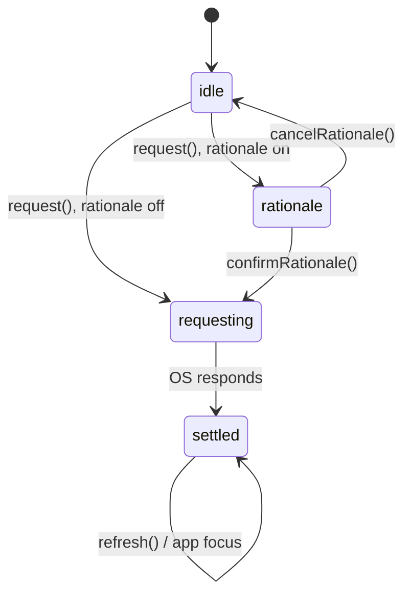

# react-native-permission-gate

[](https://www.npmjs.com/package/react-native-permission-gate)
[](https://github.com/cengizemre/react-native-permission-gate/actions/workflows/ci.yml)
[](./LICENSE)
[](./src/types.ts)

Headless permission-flow orchestration for React Native: a state-machine hook, rationale gating, and a `<PermissionGate>` component. Bring your own UI.

`react-native-permissions` gives you the native call. The flow around it - show a pre-prompt, request, detect "denied", route to Settings, re-check when the user comes back - is what everyone hand-writes in every app. This library is that flow, as a headless state machine. It renders nothing and ships no modals.

```tsx
const cam = usePermission('camera', { rationale: true });

<Button title="Enable camera" onPress={cam.request} />;
{cam.phase === 'rationale' && <MyPrePrompt onConfirm={cam.confirmRationale} onCancel={cam.cancelRationale} />}
{cam.isBlocked && <MyBlockedNotice onOpenSettings={cam.openSettings} />}
```

---

## Why

- No baked-in modals or styles - it's headless, so you drive your own components off `status` / `phase`.
- A real, testable state machine (`idle → rationale → requesting → settled`) instead of ad-hoc booleans.
- One hook covers the whole flow: check, rationale pre-prompt, native prompt, blocked → Settings, and focus re-validation.
- `request()` resolves with the final status, so it works imperatively (`await`) or declaratively (render on `phase`).
- The core has zero native dependencies, so your flows unit-test without a device.
- Full TypeScript with a normalized cross-platform status model.

## Installation

```sh
yarn add react-native-permission-gate react-native-permissions
# or
npm install react-native-permission-gate react-native-permissions
```

`react-native-permissions` is a peer dependency and needs its own one-time native setup (iOS `Podfile` `setup_permissions` + `Info.plist` usage strings, Android manifest entries). Follow its [setup guide](https://github.com/zoontek/react-native-permissions#setup) - that's the only native step.

## Quick start

```tsx
import { usePermission } from 'react-native-permission-gate';

function CameraButton() {
  const cam = usePermission('camera', { rationale: true });

  return (
    <>
      <Button title="Enable camera" onPress={() => cam.request()} />

      <Modal visible={cam.phase === 'rationale'} transparent>
        <PrePrompt
          onConfirm={cam.confirmRationale}
          onCancel={cam.cancelRationale}
        />
      </Modal>

      {cam.isBlocked && <BlockedNotice onPress={cam.openSettings} />}
    </>
  );
}
```

Prefer a declarative gate? Same flow, less wiring:

```tsx
import { PermissionGate } from 'react-native-permission-gate';

<PermissionGate
  name="camera"
  rationale={({ confirm, cancel }) => <PrePrompt onConfirm={confirm} onCancel={cancel} />}
  blocked={({ openSettings }) => <BlockedNotice onPress={openSettings} />}
  fallback={<Spinner />}
>
  <CameraView />
</PermissionGate>
```

## Core concepts

Two independent axes - kept separate on purpose:

| `status` (the OS truth) | Meaning |
| --- | --- |
| `granted` | Access allowed |
| `limited` | Partial access (iOS: selected photos/contacts) |
| `requestable` | Not granted yet, but the OS prompt can still show |
| `blocked` | Denied; the OS won't prompt again - only Settings helps |
| `unavailable` | Not supported on this device/build |

| `phase` (the flow position) | Meaning |
| --- | --- |
| `idle` | Nothing in flight |
| `rationale` | Your pre-prompt is showing, awaiting the user's choice |
| `requesting` | The native OS dialog is up |
| `settled` | The flow finished - read `status` for the outcome |



When `request()` is called on a status that can't be prompted (`granted`, `blocked`, `limited`, `unavailable`), the machine settles immediately and resolves - so a `blocked` result is something you _react to_, never a dead end.

## API

### `usePermission(name, options?)`

```ts
const controller = usePermission('camera', {
  rationale: false,          // gate the native prompt behind a `rationale` phase
  revalidateOnFocus: true,   // re-check when the app returns to the foreground
  requestOnMount: false,     // run the flow automatically on mount
  onStatusChange: (s) => {}, // called when the resolved status changes
  adapter,                   // override the backend (defaults to react-native-permissions)
});
```

Returns a `PermissionController`:

| Field | Type | Description |
| --- | --- | --- |
| `status` | `PermissionStatus` | Current OS truth |
| `phase` | `FlowPhase` | Current flow position |
| `isGranted` | `boolean` | `status === 'granted'` |
| `isBlocked` | `boolean` | `status === 'blocked'` |
| `request()` | `() => Promise<PermissionStatus>` | Run the flow; resolves with the final status |
| `confirmRationale()` | `() => void` | Proceed from `rationale` to the native prompt |
| `cancelRationale()` | `() => void` | Abort `rationale`, back to `idle` |
| `openSettings()` | `() => Promise<void>` | Open this app's OS settings |
| `refresh()` | `() => Promise<PermissionStatus>` | Re-check on demand |

Concurrent/double `request()` calls are de-duplicated - a double-tap never fires two native prompts or orphans a promise.

### `usePermissions(names, options?)`

Aggregate variant for permissions acquired together (e.g. camera + microphone for video). One shared rationale gate, one `request()`, one status map. Pass a **stable / memoized** `names` array.

```tsx
const media = usePermissions(['camera', 'microphone'], { rationale: true });

media.statuses; // { camera: 'granted', microphone: 'requestable' }
media.allGranted; // every requested permission is granted
media.anyBlocked; // at least one is blocked

<Button title="Start recording" onPress={media.request} />;
{media.phase === 'rationale' && (
  <MediaPrePrompt onConfirm={media.confirmRationale} onCancel={media.cancelRationale} />
)}
```

`request()` prompts each not-yet-granted permission in turn (behind the single shared rationale gate) and resolves with the final status map. Already-granted permissions are skipped; `allGranted` counts only `granted` as satisfied.

### `<PermissionGate>`

Declarative wrapper over the hook. Renders `children` once granted (or `limited`); otherwise renders your `rationale` / `blocked` / `fallback`. Pass a **function** as `children` to take full control for every state.

Unlike the bare hook, the gate starts the request flow automatically on mount (`requestOnMount: true`) — override it via `options` if you want a manual trigger.

```tsx
<PermissionGate name="microphone" options={{ rationale: true }}>
  {(p) => <Text>{p.status} / {p.phase}</Text>}
</PermissionGate>
```

### `<PermissionProvider>`

Optional. Sets a shared adapter and default options for the subtree - the hook works fine without it.

```tsx
<PermissionProvider defaults={{ rationale: true, revalidateOnFocus: true }}>
  <App />
</PermissionProvider>
```

### Imperative (outside React)

For services, sagas, and utilities - the raw calls, no rationale UX:

```ts
import {
  checkPermission,
  requestPermission,
  openAppSettings,
} from 'react-native-permission-gate';

const status = await checkPermission('camera');
```

## Supported permissions

**Cross-platform:** `camera`, `microphone`, `photoLibrary`, `contacts`, `calendar`, `calendarWriteOnly`, `locationWhenInUse`, `locationAlways`, `notifications`, `bluetooth`, `motion`.

**iOS only:** `photoLibraryAddOnly`, `mediaLibrary`, `reminders`, `speechRecognition`, `appTrackingTransparency`, `faceId`.

**Android only:** `storageReadAudio`, `storageReadVideo`, `bodySensors`.

Each alias maps to the correct native permission per platform; anything not meaningful on the current platform resolves to `unavailable`. Need more? Provide a custom `adapter` - or open an issue.

## Testing your flows

Because the core is adapter-agnostic, you can test permission logic with a mock adapter - no device, no native module:

```ts
const adapter: PermissionAdapter = {
  isSupported: () => true,
  check: async () => 'requestable',
  request: async () => 'granted',
  openSettings: async () => {},
};

const { result } = renderHook(() => usePermission('camera', { adapter }));
```

## License

MIT © [Emre Cengiz](https://github.com/cengizemre)
